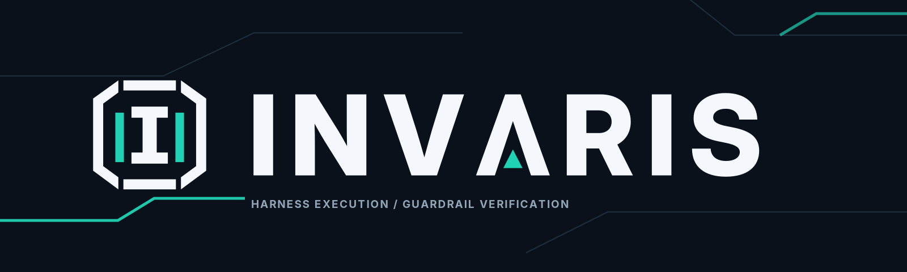

# Invaris



**Execution under invariants.**

Invaris is an experimental, standalone harness execution, guardrail verification, and mutation-testing engine. It is designed for multi-language workflows and tool adapters. The initial implementation is a deliberately small Go CLI with a standard-library Go core and optional external analyzers.

> **Status: experimental local CLI.** Invaris runs trusted commands and provider guards and verifies controlled file-mutation proofs and single-mutant test experiments. See the [provider support matrix](docs/provider-support.md) for the tested integrations.

Version [0.1.0](CHANGELOG.md#010).

## Install the CLI

Download the archive for your system from the [v0.1.0 release](https://github.com/akkaraponph/invaris/releases/tag/v0.1.0). Archives are available for Linux and macOS on `amd64` and `arm64`. Each contains `invaris`, `invaris-command-provider`, the license, and a README.

For example, use a new directory and the [GitHub CLI](https://cli.github.com/) on macOS arm64:

```sh
mkdir invaris-cli
cd invaris-cli
gh release download v0.1.0 --repo akkaraponph/invaris --pattern 'invaris_0.1.0_darwin_arm64.tar.gz' --pattern SHA256SUMS
shasum -a 256 -c --ignore-missing SHA256SUMS
tar -xzf invaris_0.1.0_darwin_arm64.tar.gz
./invaris
```

`./invaris` prints usage and exits with status 2 when invoked without an action. Choose the archive matching your system and put both executables on your `PATH` to invoke them by name. The command provider is needed for harnesses that use it. The archive does not include example harnesses, so clone the repository to try the commands below.

For your own project, put a trusted `invaris.json` in the project directory and run `invaris check`, `invaris run`, or `invaris challenge`. Pass a harness path as the last argument to select another file. Run `invaris --report report.json check invaris.json` to save the JSON report to a new file. See the [harness specification](docs/harness-spec.md) for configuration and the [mutation contract](docs/harness-spec.md#single-mutant-harness) for `mutate`.

## Quick start

Requires Go 1.27.4 or later and a POSIX shell for the bundled demonstration.

```sh
go test ./...
go run ./cmd/invaris check examples/invaris.json
go run ./cmd/invaris challenge examples/invaris.json
go run ./cmd/invaris run examples/invaris.json
```

These three commands emit `invaris.evidence/v1alpha2` JSON for v1alpha1 and v1alpha2 harnesses. Exit `0` means acceptance, `1` means a step or policy failure or an unproven challenge, and `2` means refusal, inconclusive execution, or a CLI or evidence error. See the [output migration](docs/evidence-schema.md#output-migration) for consumers of the previous format.

## Single-mutant example

Build the CLI and run the three offline POSIX fixtures:

```sh
go build -o /tmp/invaris ./cmd/invaris
/tmp/invaris mutate examples/mutation/killed.json
/tmp/invaris mutate examples/mutation/survived.json
/tmp/invaris mutate examples/mutation/invalid.json
```

The fixtures report `KILLED` (exit 0), `SURVIVED` (exit 1), and `INVALID` (exit 2), respectively. Each uses a v1alpha3 harness and emits v1alpha3 evidence. An unhealthy baseline or insufficient evidence reports `INCONCLUSIVE` (exit 2). See the [single-mutant harness contract](docs/harness-spec.md#single-mutant-harness) and [mutation evidence](docs/evidence-schema.md#mutation-experiments).

## How it works

The versioned JSON harness describes ordered `steps`, independent `guards`, and `challenges`. Each command specifies an executable and arguments; the engine does not implicitly invoke a shell. A command may explicitly invoke a shell, as the bundled POSIX example does. Treat all harness configuration as trusted code.

- `run`: execute steps in order; stop on first failed step, then run all guards.
- `check`: execute guards without steps.
- `challenge`: create a separate temporary workspace, run a clean baseline guard there, replace one expected marker, and require the selected guard to produce the expected finding for that policy, native rule, and file. Legacy marker-only guards can produce weak proofs.

A challenge is `PROVEN` under the legacy weak output-marker contract only when the baseline passed and the mutated guard failed with the expected evidence. This does not establish a structured rule identity. A missing executable, timeout, workspace error, or ambiguous replacement is `INCONCLUSIVE`. A challenge that does not detect the injected violation is `UNPROVEN`.

### Example configuration

See [`examples/invaris.json`](examples/invaris.json) and [`examples/source.txt`](examples/source.txt). For an actual project, put `invaris.json` in the repository root and set the check commands to use that project's installed tools.

## Security and evidence limits

Run only trusted harnesses, executables, and analyzer configs. Commands have the invoking user's permissions and can access external paths and the network. `writablePaths` constrains the engine's replacement and `networkPolicy` declares unrestricted access. The engine caps command time and output, and the copier rejects symlinks and special files and limits copies to 2,000 entries and 10 MiB per file. See the [threat model](docs/threat-model.md).

## Architecture direction

See [`docs/architecture.md`](docs/architecture.md) for runtime, adapter contracts, and guard lifecycle, and the [roadmap](docs/roadmap.md) for follow-up work. Invaris is intentionally independent from Panda Suite and can be called from any AI skill, CI job, or developer workflow.

## Related Projects

Invaris runs checks and uses controlled changes to verify that a guard detects the expected violation. The [open-source ecosystem catalog](docs/ecosystem.md) lists related tools for API and integration testing, architecture rules, fault injection, mutation and property-based testing, policy enforcement, and security scanning.

## Contributing

Develop changes on a topic branch and open a pull request targeting `staging`. Promote tested changes from `staging` to `main` with a pull request. Pull requests targeting `main` require the Linux, macOS, and Dependency-Cruiser checks. See the [contribution guide](CONTRIBUTING.md) for local validation and the [branch ruleset](https://github.com/akkaraponph/invaris/rules/27257768) for merge requirements.

## License

The source repository has an Apache-2.0 license. The optional [Dependency-Cruiser](docs/provider-support.md) tool uses the MIT license.

## Structured command guards

The [structured fixture](examples/structured/invaris.json) demonstrates exact policy and path matching with the [inspection contract](docs/inspection.md). Legacy guards still use exit status and optional weak output-marker proof.

Child commands and bare executable lookup use `/usr/bin:/bin` unless `PATH` is allowlisted. Lookup skips empty and relative PATH entries. Other environment variables are inherited only when allowlisted. Linux and macOS cancellation targets the command's process group. Detached descendants can escape it. Report redaction covers literal values explicitly configured in `redactEnv`.

Use `invaris --report new-file.json check examples/invaris.json` to save the same JSON emitted on stdout. The destination must be new and on a filesystem that supports hard links. A save error exits with status 2 before emitting a verdict.
